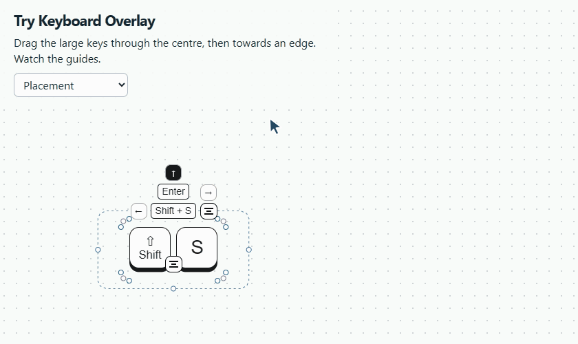
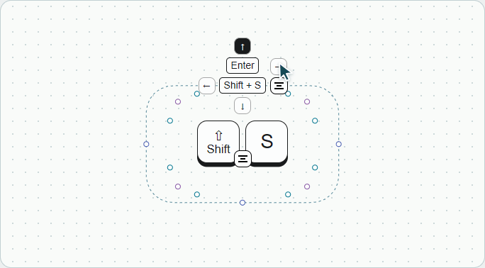
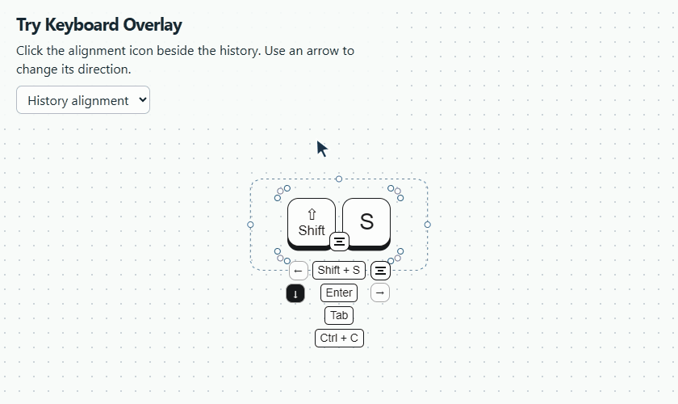
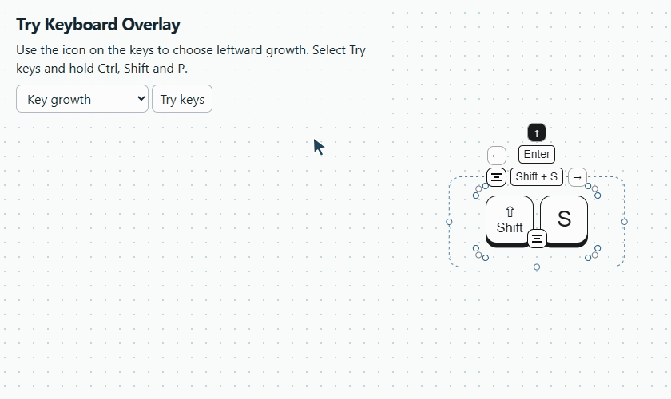
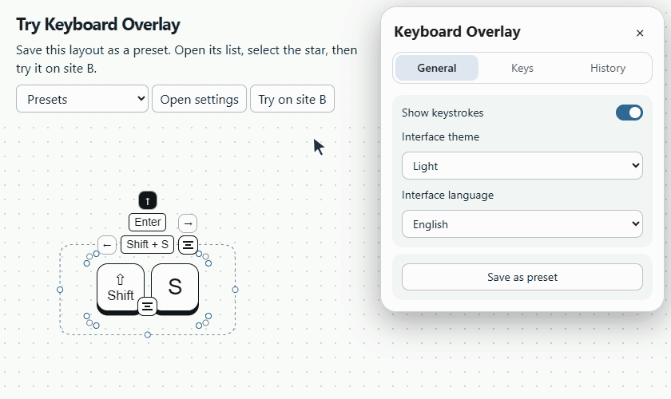

# Keyboard Overlay

English · [Русский](README.ru.md)

Show keystrokes and shortcuts on a web page during a recording or presentation. [Try the interactive demo][demo] to move the keys and history yourself.

## Installation

1. [Download the ZIP][zip] and extract it into a folder you intend to keep.
2. Open `chrome://extensions`, `edge://extensions` or `brave://extensions` and enable **Developer mode**.
3. Click **Load unpacked** and select the folder containing `manifest.json`.

On a regular web page, press a shortcut to see it on screen. Click **Keyboard Overlay** in the extensions menu to edit the sample layout. Close settings to return to live keystrokes. For an English interface, select **English** under **Общие → Язык интерфейса**.

## Move the keys

Drag the large keys towards the centre or an edge of the page. A guide appears when the block snaps into place. Keep dragging to pull it free.

## Place history around the keys

Grab the history entry closest to the keys. Follow the dotted orbit and release when the guide marks the position you want. **History → Distance from the keys** adjusts the gap around the block.

## Align the history

For a vertical list, click the alignment icon beside the first entry to cycle through the available left, centre and right alignments. Click an arrow to choose where subsequent entries appear. Under **History**, the count below the limit shows how many entries fit.

## Choose where a shortcut grows

Click the alignment icon on the large keys to change where each additional key appears. Near the right edge, choose leftward growth to keep the right end of the shortcut in place.

## Reuse a layout on new sites

Choose **Save as preset** and enter a name. Open the preset list, click **☆** beside the name and confirm. A site with no saved layout now starts with this preset.

[demo]: https://dmitriymih.github.io/keyboard-overlay/docs/demo/
[zip]: https://github.com/DmitriyMih/keyboard-overlay/releases/download/v1.8.0/keyboard-overlay-1.8.0.zip
