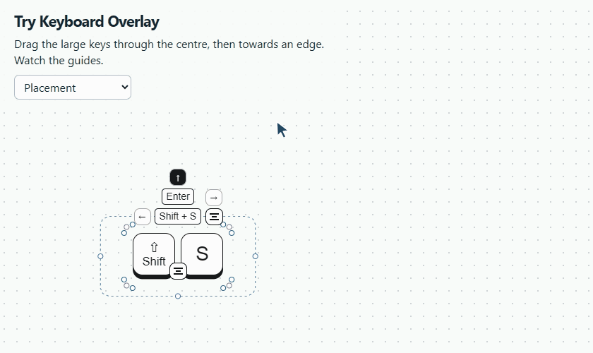
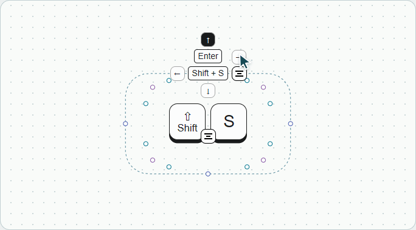
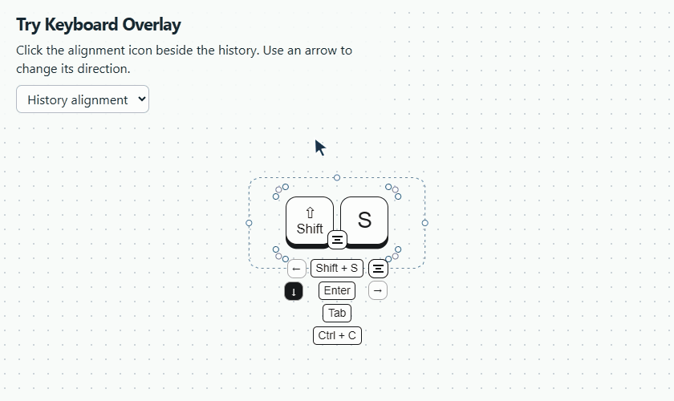
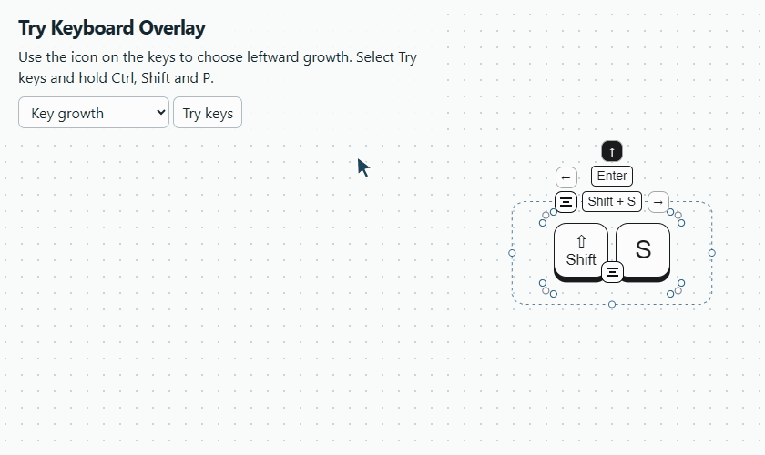
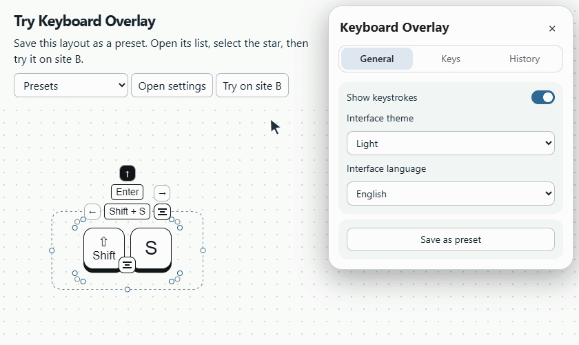

# Keyboard Overlay

[English](README.md) · Русский

Показывает нажатия клавиш и сочетания прямо на веб-странице во время записи или презентации. В [интерактивной демонстрации][demo] можно самому подвигать клавиши и историю.

## Установка

1. [Скачайте ZIP][zip] и распакуйте его в постоянную папку.
2. Откройте `chrome://extensions`, `edge://extensions` или `brave://extensions` и включите **Режим разработчика**.
3. Нажмите **Загрузить распакованное расширение** и выберите папку с `manifest.json`.

На обычной веб-странице нажмите сочетание клавиш. Чтобы настроить раскладку, откройте **Keyboard Overlay** в меню расширений. В настройках появятся образцы клавиш и истории. Закройте настройки, чтобы увидеть свои нажатия.

## Переместить клавиши

Потяните блок больших клавиш к центру или краю страницы. При прилипании появится направляющая. Продолжайте тянуть, чтобы освободить блок.

## Разместить историю по орбите

Возьмитесь за ближайшую к клавишам запись истории. Ведите её по пунктирной орбите и отпустите, когда направляющая отметит нужное положение. Расстояние от блока регулируется во вкладке **История** ползунком **Радиус орбиты**.

## Выровнять строки истории

В вертикальном списке нажимайте значок выравнивания рядом с первой записью. Строки разной длины выстроятся по левому краю, по центру или по правому краю — в зависимости от доступного места. Стрелка задаёт направление, в котором появятся следующие записи. Во вкладке **История** под лимитом указано, сколько записей поместится на экране.

## Выбрать, куда добавлять клавиши

Нажимайте значок выравнивания на самих больших клавишах, чтобы выбрать направление роста сочетания. У правого края удобно добавлять клавиши влево — тогда правый край сочетания остаётся на месте.

## Применить раскладку на новых сайтах

Нажмите **Сохранить как пресет** и введите имя. Раскройте список пресетов, нажмите **☆** рядом с названием и подтвердите выбор. На сайте без сохранённых настроек теперь откроется эта раскладка.

[demo]: https://dmitriymih.github.io/keyboard-overlay/docs/demo/
[zip]: https://github.com/DmitriyMih/keyboard-overlay/releases/download/v1.8.0/keyboard-overlay-1.8.0.zip
